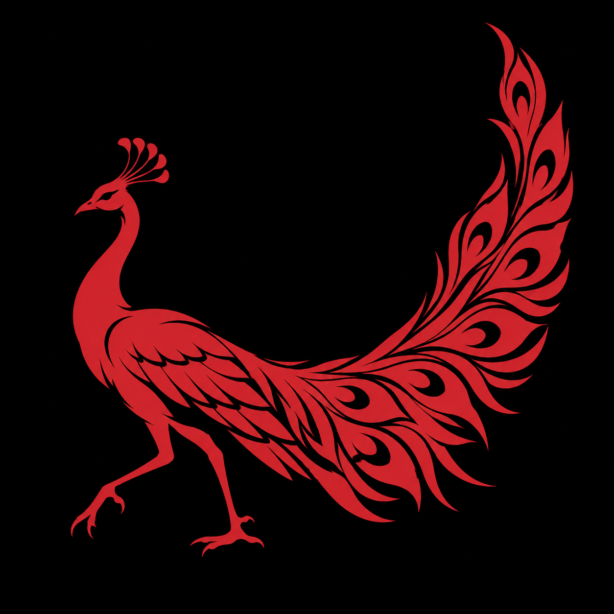
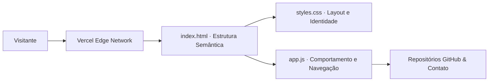

<p align="center">
  
</p>

<h1 align="center">portfolio</h1>

<p align="center">Portfólio de Arthur Mendes Entsev com projetos, tecnologias e experiência profissional.</p>

<p align="center">
  
  
  
</p>

<p align="center"><a href="#visão-geral">Visão geral</a> &nbsp;·&nbsp; <a href="#recursos">Recursos</a> &nbsp;·&nbsp; <a href="#como-executar">Como executar</a></p>

---

## Visão geral

O portfólio reúne minha atuação prática na **Flash Engenharia**, minha formação em **Análise e Desenvolvimento de Sistemas (Fatec Sorocaba)** e links diretos para as demonstrações e repositórios dos meus principais sistemas.

## Recursos

| Recurso | Como funciona |
|---|---|
| Vitrine de projetos | Cards interativos destacando arquitetura, tecnologias utilizadas e acesso direto ao código no GitHub. |
| Apresentação profissional | Resumo objetivo da trajetória em back-end, automação de engenharia e bancos de dados. |
| Interatividade leve (app.js) | Animações de rolagem, navegação dinâmica e interações de interface sem peso de frameworks externos. |
| Identidade visual própria | Estilização em styles.css e ícone vetorial exclusivo (favicon.svg). |

<details>
<summary>Arquitetura</summary>



</details>

<details>
<summary>Estrutura do repositório</summary>

```text
portfolio/
├── assets/
│   └── project-animal.png          Emblema do projeto
├── index.html                      Página principal do portfólio
├── styles.css                      Folha de estilos responsiva e animações
├── app.js                          Scripts de interação e navegação
├── favicon.svg                     Ícone vetorial da aba do navegador
└── README.md
```

</details>

## Como executar

1. Acesse diretamente **[arthurentsev.vercel.app](https://arthurentsev.vercel.app/)** ou clone o repositório para execução local:
   ```bash
   git clone https://github.com/arthurlynow098/portfolio.git
   cd portfolio
   ```
2. Abra index.html em qualquer navegador moderno.

---

<p align="center">
  <a href="https://github.com/arthurlynow098">GitHub</a> &nbsp;·&nbsp;
  <a href="https://arthurentsev.vercel.app/">Portfólio</a> &nbsp;·&nbsp;
  <a href="https://www.linkedin.com/in/entsevarthur/">LinkedIn</a>
</p>
