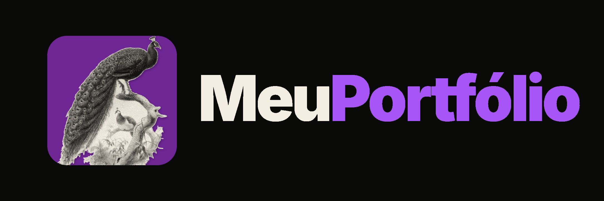
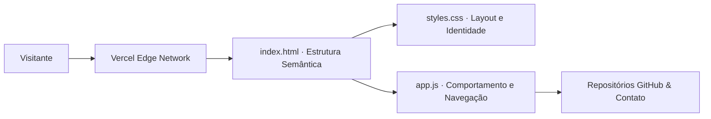

<a id="top"></a>

<p align="center"><sub>Portfólio</sub></p>

---

<p align="center"></p>

<p align="center">Portfólio de Arthur Mendes Entsev com projetos, tecnologias e experiência profissional.</p>

<p align="center">


</p>

<p align="center"><a href="#visão-geral">Visão geral</a> &nbsp;·&nbsp; <a href="#recursos">Recursos</a> &nbsp;·&nbsp; <a href="#como-executar">Como executar</a></p>

<a id="explore-o-projeto"></a>

<a id="por-onde-começar"></a>

## Por onde começar

- **[Conteúdo](index.html)**, página com apresentação e projetos.
- **[Visual](styles.css)**, layout, cores e estilos da interface.
- **[Interação](app.js)**, comportamentos implementados em JavaScript.

<a id="visão-geral"></a>

<a id="sobre-o-projeto"></a>

## Sobre o projeto

O portfólio reúne minha atuação prática na **Flash Engenharia**, minha formação em **Análise e Desenvolvimento de Sistemas (Fatec Sorocaba)** e links diretos para as demonstrações e repositórios dos meus principais sistemas.

<a id="recursos"></a>

## Recursos

**Vitrine de projetos**<br>
Cards interativos destacando arquitetura, tecnologias utilizadas e acesso direto ao código no GitHub.

**Apresentação profissional**<br>
Resumo objetivo da trajetória em back-end, automação de engenharia e bancos de dados.

**Interatividade leve (app.js)**<br>
Animações de rolagem, navegação dinâmica e interações de interface sem peso de frameworks externos.

**Identidade visual própria**<br>
Estilização em styles.css e ícone vetorial exclusivo (favicon.svg).

<a id="arquitetura"></a>

## Arquitetura



<a id="estrutura-do-repositório"></a>

## Estrutura do repositório

```text
portfolio/
├── assets/
│   └── identity/banner.png               Banner do projeto
├── index.html                      Página principal do portfólio
├── styles.css                      Folha de estilos responsiva e animações
├── app.js                          Scripts de interação e navegação
├── favicon.svg                     Ícone vetorial da aba do navegador
└── README.md
```

<a id="como-executar"></a>

## Como executar

1. Acesse diretamente **[arthurentsev.vercel.app](https://arthurentsev.vercel.app/)** ou clone o repositório para execução local
   ```bash
   git clone https://github.com/arthurlynow098/portfolio.git
   cd portfolio
   ```
2. Abra index.html em qualquer navegador moderno.

<p align="center">
  <a href="https://github.com/arthurlynow098">GitHub</a> &nbsp;·&nbsp;
  <a href="https://arthurentsev.vercel.app/">Portfólio</a> &nbsp;·&nbsp;
  <a href="https://www.linkedin.com/in/entsevarthur/">LinkedIn</a>
</p>

<a id="identidade-e-créditos"></a>

## Identidade e créditos

<table><tr><td width="150"></td><td><strong>Pavão</strong><br>Apresentação visual do trabalho desenvolvido.<br><br><a href="assets/identity-v2/logo.png">Logo em PNG</a> · <a href="assets/identity-v2/banner.png">Banner em PNG</a></td></tr></table>

A gravura do banner é o pavão de Joseph Wolf, litografado por J. Smit, em domínio público no [Wikimedia Commons](https://commons.wikimedia.org/wiki/File%3AJ_Smit_nach_Joseph_Wolf_Pavo_Cristatus_1.jpg).

<p align="center"><a href="#top">Voltar ao topo ↑</a> · <a href="https://github.com/arthurlynow098">Arthur Entsev</a> · <a href="https://arthurentsev.vercel.app/">Portfólio</a></p>
