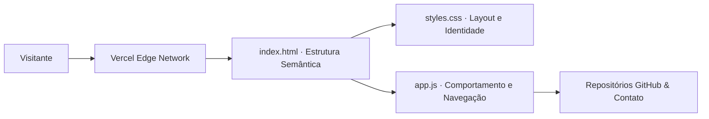

<p align="center"></p>

<p align="center">Portfólio de Arthur Mendes Entsev com projetos, tecnologias e experiência profissional.</p>


<p align="center"><a href="#visão-geral">Visão geral</a> &nbsp;·&nbsp; <a href="#recursos">Recursos</a> &nbsp;·&nbsp; <a href="#como-executar">Como executar</a></p>

---

<a id="explore-o-projeto"></a>

## Por onde começar


- **[Conteúdo](index.html)** — Página com apresentação e projetos.
- **[Visual](styles.css)** — Layout, cores e estilos da interface.
- **[Interação](app.js)** — Comportamentos implementados em JavaScript.


<a id="visão-geral"></a>

## Sobre o projeto

O portfólio reúne minha atuação prática na **Flash Engenharia**, minha formação em **Análise e Desenvolvimento de Sistemas (Fatec Sorocaba)** e links diretos para as demonstrações e repositórios dos meus principais sistemas.

<a id="recursos"></a>

## Recursos

**Vitrine de projetos**<br>
Cards interativos destacando arquitetura, tecnologias utilizadas e acesso direto ao código no GitHub.

**Apresentação profissional**<br>
Resumo objetivo da trajetória em back-end, automação de engenharia e bancos de dados.

**Interatividade leve (app.js)**<br>
Animações de rolagem, navegação dinâmica e interações de interface sem peso de frameworks externos.

**Identidade visual própria**<br>
Estilização em styles.css e ícone vetorial exclusivo (favicon.svg).

## Arquitetura





## Estrutura do repositório


```text
portfolio/
├── assets/
│   └── identity/banner.png               Banner do projeto
├── index.html                      Página principal do portfólio
├── styles.css                      Folha de estilos responsiva e animações
├── app.js                          Scripts de interação e navegação
├── favicon.svg                     Ícone vetorial da aba do navegador
└── README.md
```


<a id="como-executar"></a>

## Como executar

1. Acesse diretamente **[arthurentsev.vercel.app](https://arthurentsev.vercel.app/)** ou clone o repositório para execução local:
   ```bash
   git clone https://github.com/arthurlynow098/portfolio.git
   cd portfolio
   ```
2. Abra index.html em qualquer navegador moderno.

---

<p align="center">
  <a href="https://github.com/arthurlynow098">GitHub</a> &nbsp;·&nbsp;
  <a href="https://arthurentsev.vercel.app/">Portfólio</a> &nbsp;·&nbsp;
  <a href="https://www.linkedin.com/in/entsevarthur/">LinkedIn</a>
</p>

## Identidade visual e créditos

**Pavão** — Apresentação visual do trabalho desenvolvido. [Logo em PNG](assets/identity-v2/logo.png).

Identidade organizada a partir das artes fornecidas por Arthur Entsev. Direção visual e organização documental inspiradas em [LynowCut](https://github.com/arthurlynow098/LynowCut) e [LynowCatch](https://github.com/arthurlynow098/LynowCatch). Tipografia **Inter**, com licença SIL Open Font License em [Inter-OFL.txt](assets/identity-v2/Inter-OFL.txt).
