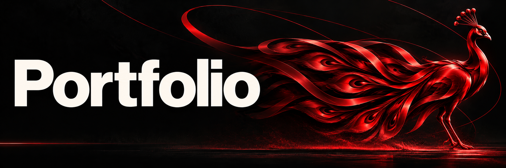
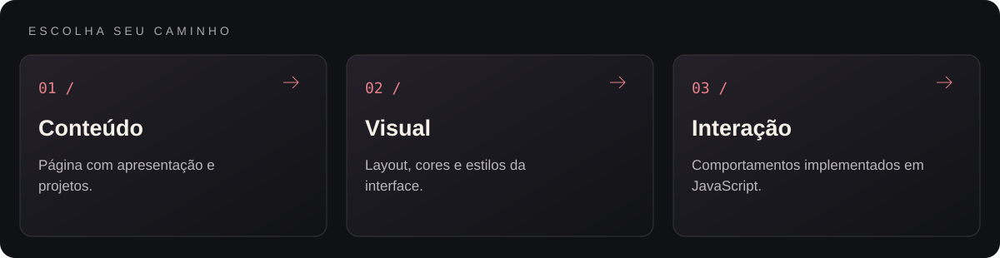
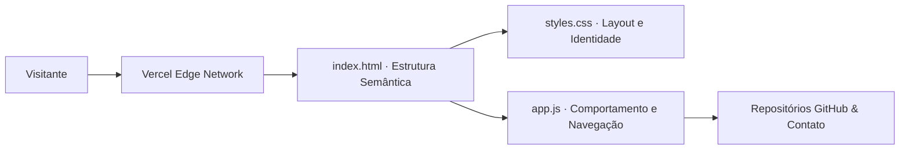

<p align="center">
  
</p>

<p align="center">Portfólio de Arthur Mendes Entsev com projetos, tecnologias e experiência profissional.</p>

<p align="center"></p>

<p align="center"><a href="#visão-geral">Visão geral</a> &nbsp;·&nbsp; <a href="#recursos">Recursos</a> &nbsp;·&nbsp; <a href="#como-executar">Como executar</a></p>

---

<a id="explore-o-projeto"></a>




<table width="100%">
<tr><th align="left">Área</th><th align="left">O que você encontra</th><th align="left">Acesso direto</th></tr>
<tr><td><strong>Conteúdo</strong></td><td>Página com apresentação e projetos.</td><td><a href="index.html">Abrir conteúdo →</a></td></tr>
<tr><td><strong>Visual</strong></td><td>Layout, cores e estilos da interface.</td><td><a href="styles.css">Abrir visual →</a></td></tr>
<tr><td><strong>Interação</strong></td><td>Comportamentos implementados em JavaScript.</td><td><a href="app.js">Abrir interação →</a></td></tr>
</table>

<a id="visão-geral"></a>


O portfólio reúne minha atuação prática na **Flash Engenharia**, minha formação em **Análise e Desenvolvimento de Sistemas (Fatec Sorocaba)** e links diretos para as demonstrações e repositórios dos meus principais sistemas.

<a id="recursos"></a>


| Recurso | Como funciona |
|---|---|
| Vitrine de projetos | Cards interativos destacando arquitetura, tecnologias utilizadas e acesso direto ao código no GitHub. |
| Apresentação profissional | Resumo objetivo da trajetória em back-end, automação de engenharia e bancos de dados. |
| Interatividade leve (app.js) | Animações de rolagem, navegação dinâmica e interações de interface sem peso de frameworks externos. |
| Identidade visual própria | Estilização em styles.css e ícone vetorial exclusivo (favicon.svg). |

<details>
<summary>Arquitetura</summary>



</details>

<details>
<summary>Estrutura do repositório</summary>

```text
portfolio/
├── assets/
│   └── banner-v2.png               Banner do projeto
├── index.html                      Página principal do portfólio
├── styles.css                      Folha de estilos responsiva e animações
├── app.js                          Scripts de interação e navegação
├── favicon.svg                     Ícone vetorial da aba do navegador
└── README.md
```

</details>

<a id="como-executar"></a>


1. Acesse diretamente **[arthurentsev.vercel.app](https://arthurentsev.vercel.app/)** ou clone o repositório para execução local:
   ```bash
   git clone https://github.com/arthurlynow098/portfolio.git
   cd portfolio
   ```
2. Abra index.html em qualquer navegador moderno.

---

<p align="center">
  <a href="https://github.com/arthurlynow098">GitHub</a> &nbsp;·&nbsp;
  <a href="https://arthurentsev.vercel.app/">Portfólio</a> &nbsp;·&nbsp;
  <a href="https://www.linkedin.com/in/entsevarthur/">LinkedIn</a>
</p>
