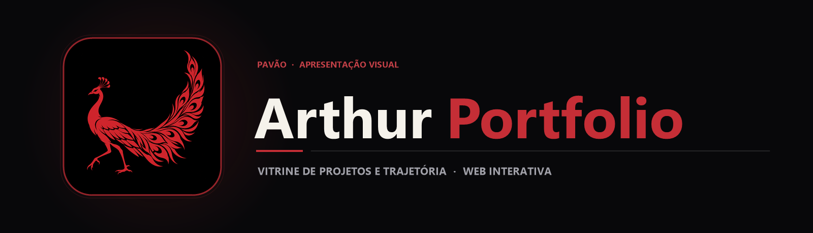

  

  Portfólio web profissional de Arthur Mendes Entsev apresentando projetos em destaque, stack tecnológica e experiência em desenvolvimento back-end e automação.

  
  
  

## Sobre o projeto

Este repositório contém o código-fonte do meu portfólio oficial hospedado em **[arthurentsev.vercel.app](https://arthurentsev.vercel.app/)**. A aplicação foi construída com **HTML5 semântico, CSS3 customizado e JavaScript puro**, priorizando carregamento instantâneo, tipografia refinada, responsividade em dispositivos móveis e navegação fluida.

O portfólio reúne minha atuação prática na **Flash Engenharia**, minha formação em **Análise e Desenvolvimento de Sistemas (Fatec Sorocaba)** e links diretos para as demonstrações e repositórios dos meus principais sistemas.

## Principais recursos

| Recurso | Como funciona |
|---|---|
| Vitrine de projetos | Cards interativos destacando arquitetura, tecnologias utilizadas e acesso direto ao código no GitHub. |
| Apresentação profissional | Resumo objetivo da trajetória em back-end, automação de engenharia e bancos de dados. |
| Interatividade leve (pp.js) | Animações de rolagem, navegação dinâmica e interações de interface sem peso de frameworks externos. |
| Identidade visual própria | Estilização em styles.css e ícone vetorial exclusivo (avicon.svg). |

## Tecnologias

  
  
  
  

## Arquitetura

`mermaid
flowchart LR
    A[Visitante] --> B[Vercel Edge Network]
    B --> C[index.html · Estrutura Semântica]
    C --> D[styles.css · Layout e Identidade]
    C --> E[app.js · Comportamento e Navegação]
    E --> F[Repositórios GitHub & Contato]
`

## Estrutura do repositório

`	ext
portfolio/
├── assets/
│   ├── banner.png                  Banner principal do repositório
│   └── project-animal.png          Símbolo do pavão
├── index.html                      Página principal do portfólio
├── styles.css                      Folha de estilos responsiva e animações
├── app.js                          Scripts de interação e navegação
├── favicon.svg                     Ícone vetorial da aba do navegador
└── README.md
`

## Executando o código

1. Acesse diretamente **[arthurentsev.vercel.app](https://arthurentsev.vercel.app/)** ou clone o repositório para execução local:
   `ash
   git clone https://github.com/arthurlynow098/portfolio.git
   cd portfolio
   `
2. Abra index.html em qualquer navegador moderno.

---

Estudo · construção · evolução <a href="https://github.com/arthurlynow098">Perfil</a> · <a href="https://arthurentsev.vercel.app/">Portfólio</a> · <a href="https://www.linkedin.com/in/entsevarthur/">LinkedIn</a>

